# Verifikations-Nachweis
Die Offline-Funktionalität unserer Konferenzwebsite „Shift“ wurde im Produktionsmodus mithilfe der Chrome DevTools überprüft. Dafür wurde die Website zuerst online geöffnet, damit der Service Worker die benötigten Dateien zwischenspeichern konnte und anschließend wurde im Network-Tab der Offline-Modus aktiviert und die Session-Übersicht sowie „Mein Programm“ erneut aufgerufen. Beide Seiten waren offline verfügbar mit den richtigen Sessions.
Im Application-Tab wurde kontrolliert, ob der Service Worker aktiviert ist und die vorgesehenen Caches angelegt wurden. Zusätzlich wurde das Web App Manifest überprüft. Chrome erkannte die Start-URL /sessions, den Darstellungsmodus standalone sowie die definierten Farben.
Das Lighthouse-Audit (Version 13.5.0) erreichte auf Desktop in allen vier Kategorien 100 Punkte. Da Lighthouse keine eigene PWA-Kategorie mehr anbietet, wurden die PWA-Eigenschaften zusätzlich manuell überprüft. Die tatsächliche Installierbarkeit wurde zusätzlich über die Installationsfunktion von Chrome überprüft und mit mehreren Screenshots dokumentiert.

## Screenshots und Testergebnisse

### 1. Lighthouse-Audit

Das Audit der Session-Übersicht erreichte in allen
vier Kategorien 100 Punkte.

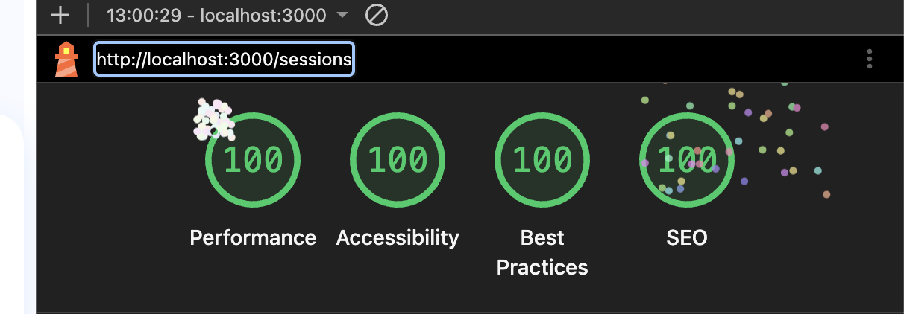

### 2. Offline-Test: Session-Übersicht

Die Session-Übersicht wurde im Offline-Modus erfolgreich erneut geladen.

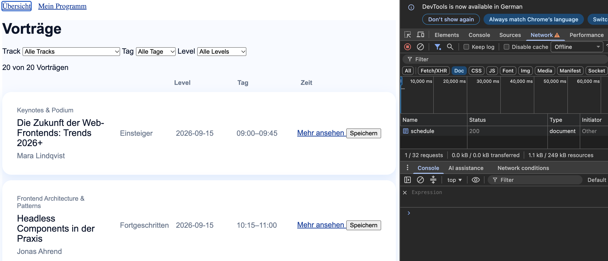

### 3. Offline-Test: Mein Programm

Die gespeicherten Sessions blieben auch offline erhalten.

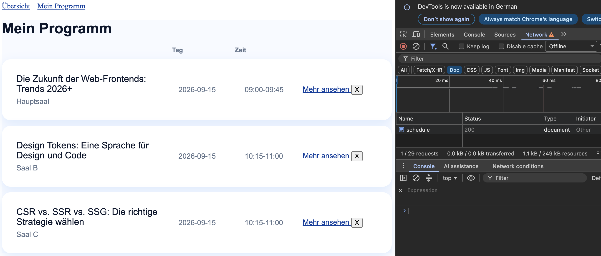

### 4. Service Worker 

Der Service Worker wurde im Application-Tab überprüft.

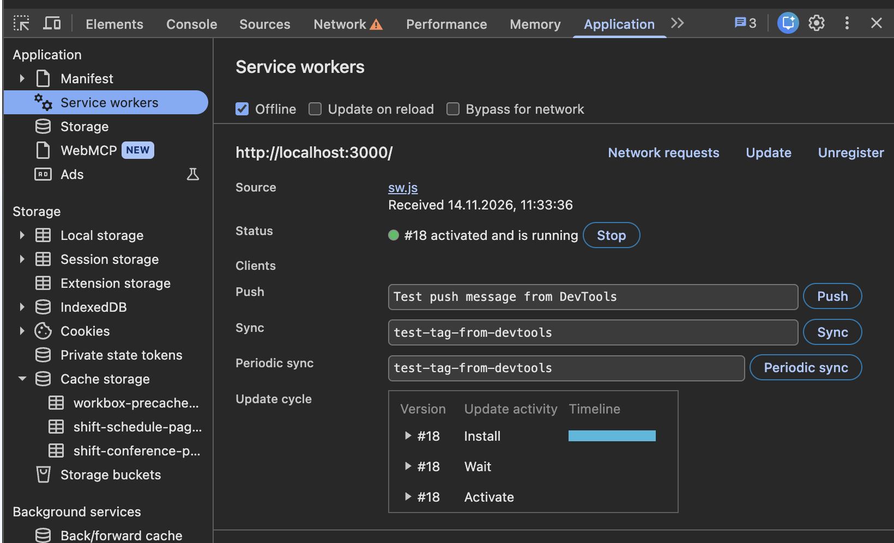

### 5. Cache Storage

Die angelegten Caches (Precache, Schedule & Sessions) wurden im Cache Storage kontrolliert.

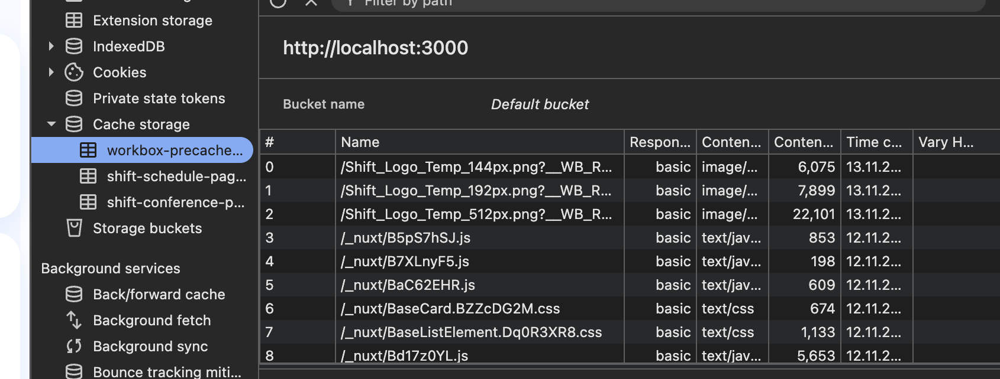
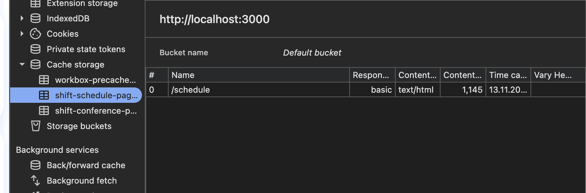
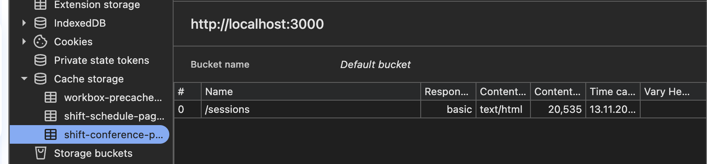

### 6. Web App Manifest

Chrome erkennt die konfigurierten Manifest-Einstellungen.

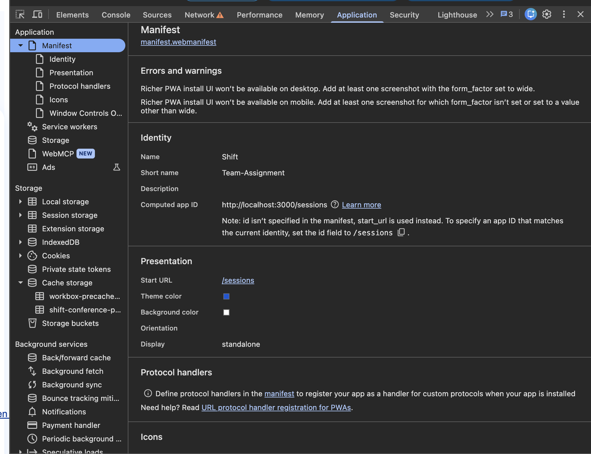

### 7. PWA Installierbarkeit

Installation in Chrome ist erfolgreich.

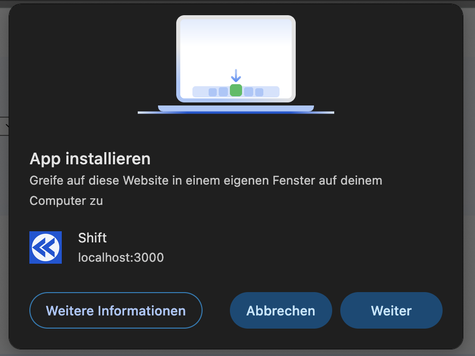
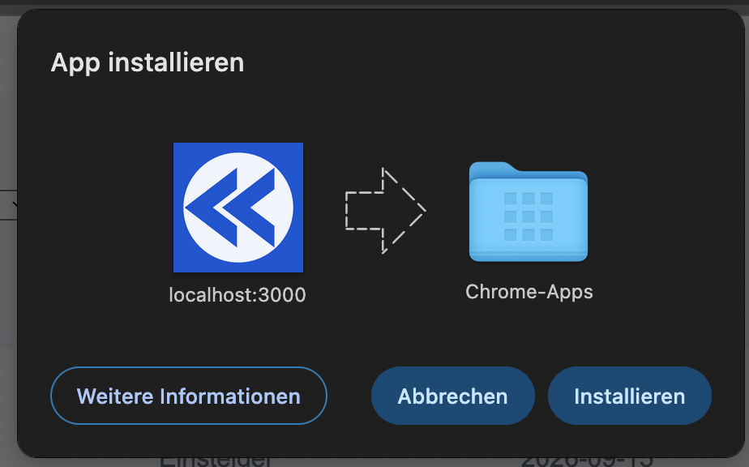
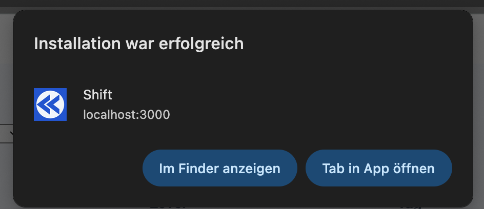
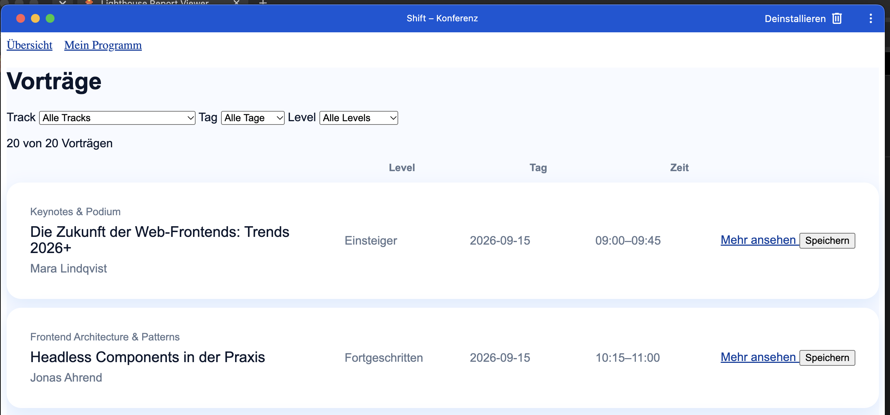