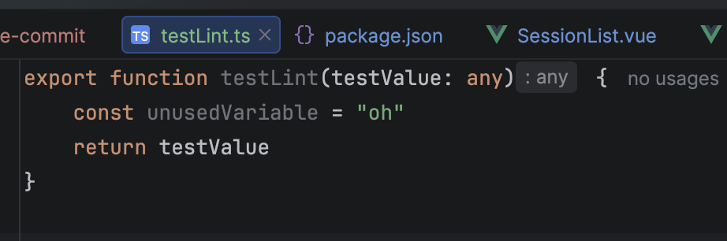
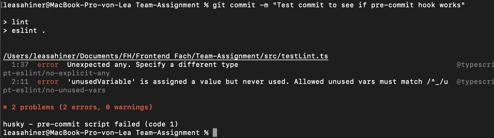

# AI Log Schritt 4
## Eintrag 1 – ESLint-Konfiguration

| Feld | Inhalt |
| --- | --- |
| Datum | 25.11.2026 |
| Tool | ChatGPT |
| Prompt | Folgendes ist die Angabe für mein Konferenz Websiten Projekt (den Angaben-abschnitt zu „Linter als Qualitäts-Gate einrichten oder schärfen“ mitgeschickt) Bitte erkläre mir wie ich die linter aufgabe genau erfülle in unserer Konferenz Webseite? empfehle mir welche Linter ich verwenden soll und warum bitte? Und erklär mir generell was ich alles beim Linter beachten muss? |
| Zweck | Erfahren welche Linter Konfiguration für unser Projekt empfohlen wird und lernen wie man ein Linter für unser Nuxt-Projekt einrichtet. |
| Übernommen | ESLint installiert, Befehle in der package.json ergänzt, ESLint-Regeln gegen any und ungenutzte Variablen, TypeScript-Check hinzugefügt, Husky als Pre-Commit-Hook einrichten |
| Korrigiert/Abgelehnt | die KI hat mir eine Alternative zu tsc --noEmit empfohlen (nuxt typecheck) aber da ich mich an die Angabe halten möchte hab ich dies zuerst nicht übernehmen wollen und nochmal nachgehakt warum er mir das empfiehlt statt tsc --noEmit und nach seiner Begründung anschließend doch das nuxt typecheck gewählt, außerdem hat er mir wesentlich mehr Befehle gezeigt als notwendig sind um die angabe zu erfüllen deswegen habe ich nur 2 weitere übernommen zusätzlich zu den notwendigen und auf eine zusätzliche Magic-Number-Regel habe ich verzichtet. |
| Prüfmethode | Geprüft habe ich es indem ich im terminal npm run lint gemacht habe und anschließend die Linter Warnungen und Fehler korrigiert habe und erneut geprüft habe, das gleiche gilt für ts-check da hab ich im terminal npm run typecheck gemacht und der war auf Anhieb erfolgreich. |

## Eintrag 2 – Lint Fehler Erklärung

| Feld                 | Inhalt                                                                                                                                                                                                                                                        |
|----------------------|---------------------------------------------------------------------------------------------------------------------------------------------------------------------------------------------------------------------------------------------------------------|
| Datum                | 26.11.2026                                                                                                                                                                                                                                                    |
| Tool                 | ChatGPT                                                                                                                                                                                                                                                       |
| Prompt               | Folgendes kam raus nach npm run lint, wie behebe ich die Fehler genau und was bedeuten sie, bzw. was genau ist hier falsch? (terminal ausgabe nach npm run lint mit 5 Warnungen und 1 Fehler mitgeschickt unter anderem: "1:1  error  The template requires child element") |
| Zweck                | Ich wollte verstehe was daran genau falsch ist und warum und wie ich die Fehler manuell korrigieren müsste                                                                                                                                                    |
| Übernommen           | Ich habe anschließend jede Warnung im Code geöffnet und händisch korrigiert, nachdem ich die Fehler erklären lassen habe. Die Fehlerbehebung habe ich händisch und ohne KI gemacht damit ich die Linter Fehler besser verstehe und damit ich besser daraus lerne.|
| Korrigiert/Abgelehnt | Die KI hat mir empfohlen für den error das leere Template mit einem div zb so `<template> 
 <h1>Speakers</h1> 
 </template>` zu befüllen, allerdings wird das hier nicht gebraucht darum hab ich stattdessen das leere Template gelöscht             |
| Prüfmethode          | Um zu überprüfen ob meine Fehler Korrektur funktioniert hat habe ich erneut npm run lint im Terminal ausgeführt und anschließend wurde keine Warnungen und Fehler mehr angezeigt.                                                                             |

## Eintrag 3 – Angaben Erfüllung Abfrage

| Feld | Inhalt |
| --- | --- |
| Datum | 26.11.2026 |
| Tool | ChatGPT |
| Prompt | Erfüllt mein code die angabe ausreichend? (Ich habe meinen Code mitgeschickt: Nuxt config, Package.json und Eslint Config) |
| Zweck | Ich wollte eine Absicherung ob ich mit meiner Konfiguration die Angabe vollständig erfülle. |
| Übernommen | Nachdem die KI meinte dass die Angabe mit meinem Code erfüllt ist, habe ich keine Ergänzungen vornehmen müssen |
| Korrigiert/Abgelehnt | In dem Fall gab es nichts dass ich ablehnen musste, ich habe nur Bestätigung gesucht und bekommen |
| Prüfmethode | Um das nochmal zu überprüfen bin ich nochmal Schritt für Schritt die Angabe durchgegangen und habe sie mit meiner Implementierung abgeglichen |

## Eintrag 4 – Tabelle machen

| Feld | Inhalt |
| --- | --- |
| Datum | 26.11.2026 |
| Tool | ChatGPT |
| Prompt | Wie mach ich eine Tabelle in einem md file (inklusive Screenshot von Angaben-abschnitt „C. AI-LOG führen (pro Person)“) |
| Zweck | die Angabe verlangt nach einer Tabelle oder strukturierten Liste und ich wollte lernen wie man eine Tabelle genau macht um das Ai log damit zu erstellen |
| Übernommen | die Tabellenvorlage für das AI-log |
| Korrigiert/Abgelehnt | die KI hat mir auch eine Alternative, eine strukturierte liste angeboten und die zur Tabelle eigentlich bevorzugt, aber ich habe mich für die Tabelle entschieden da ich die noch übersichtlicher fand |
| Prüfmethode | Ich habe dies überprüft indem ich beim md file mir die Editor and Preview Ansicht angeklickt und betrachtet habe ob die Tabelle richtig funktioniert |

## Fehlerhafter Commit wurde geblockt - Nachweis:

Testfile für den fehlerhaften Commit:

Screenshot vom Terminal, der zeigt, dass der Commit geblockt wurde aufgrund von Linter Überprüfung

## Beispiele für Dinge, die bewusst nicht mit AI gemacht worden sind und warum:
Da ich eine fixe Idee für das UI Design hatte, habe ich die Design Entscheidungen wie z.B. Farben, Schatten, Rundungen selbst getroffen, denn ich wollte kein AI generiertes Design haben sondern was eigenes kreieren um ein authentisches Design zu schaffen.
Außerdem habe ich damit ich die Linter Fehler besser verstehe, sie mir zwar erklären lassen allerdings die Fehlerbehebung manuell gemacht damit ich besser daraus lerne.

